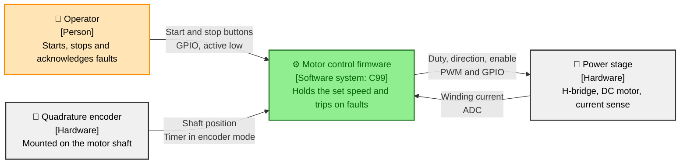

# System context

The firmware holds a brushed DC motor at a set speed. It reads the shaft speed from a quadrature encoder and the winding current from a current-sense amplifier, and it drives the motor through an H-bridge. An operator starts and stops the motor with two push buttons. The firmware switches the drive off on overcurrent or stall, and keeps it off until the operator presses stop.

This overview diagram is for a reader who is new to the project. It shows the firmware as one box, and every piece of hardware that the firmware exchanges signals with. Arrows point the way each signal travels.

The symbols and colors follow [Diagram conventions](00_diagram_conventions.md). `src/bsp/board_config.h` holds the pin, channel and scaling values for each arrow.

## What the system promises

| Promise | Requirement |
| --- | --- |
| Speed within 2 % of the setpoint, settled within 1 s of start | [LINK: SYS-001] |
| Start and stop from the buttons | [LINK: SYS-002] |
| Drive disabled within one 1 ms control period of an overcurrent | [LINK: SYS-003] |
| Drive disabled when the motor is driven but does not turn | [LINK: SYS-004] |
| Drive stays off until the operator presses stop to acknowledge a fault | [LINK: SYS-005] |
| Logic above the HAL port builds unchanged for any MCU | [LINK: SYS-006] |
| Fixed 1 ms control period, same outputs for the same inputs on every target | [LINK: SYS-007] |
| All logic above the HAL port tests on a PC | [LINK: SYS-008] |

The `[LINK: ...]` tags resolve to the requirement pages in the StrictDoc export. On GitHub they show as plain text.

## Out of scope

The firmware has no communication interface, no non-volatile parameter storage and no bootloader. The setpoint and every threshold are compile-time constants in `src/app/app_config.h`.
