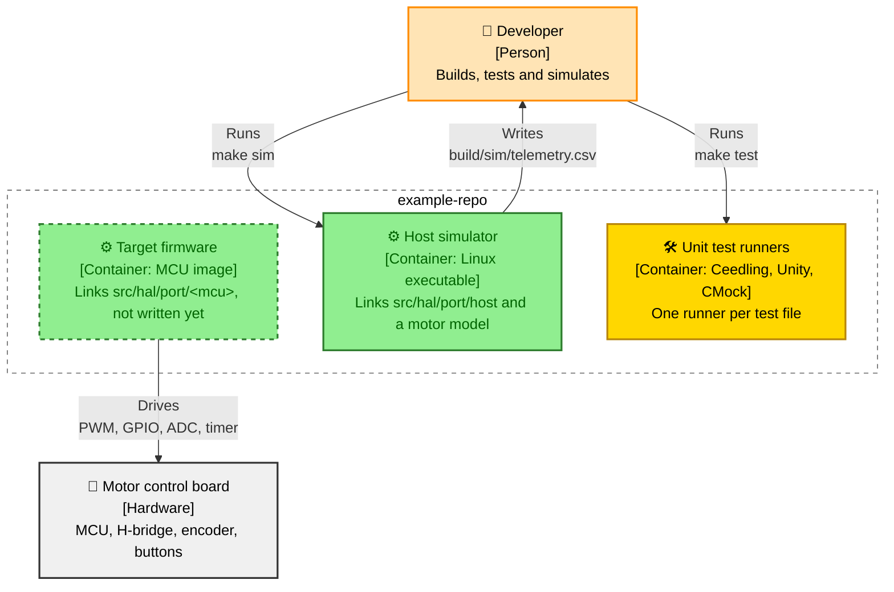

# Containers

One source tree builds three executables. The target firmware and the host simulator compile the same `app`, `domain`, `middleware` and `bsp` sources. They differ only in the HAL port that stands behind the HAL headers. The simulator is therefore the evidence for the portability requirement {need}`SYS-006`. The unit test runners compile one module at a time against CMock mocks.

This overview diagram shows the three executables and who runs each one. The second line of each box names the C4 element type and how the executable is built. Arrows point the way a command or data travels.

The dashed border marks the target firmware as planned work, because no MCU port exists yet. [Port the firmware to a new MCU](06_porting_guide.md) lists the files that a port needs. Source sets and HAL ports are not containers, because none of them is deployed on its own. They appear on the [component page](03_components.md).

| Container | Command | Compiles | HAL behind the headers | Purpose |
| --- | --- | --- | --- | --- |
| Target firmware | The vendor toolchain for the chosen MCU | `src/app`, `src/domain`, `src/middleware`, `src/bsp`, `src/hal/port/<mcu>/` | The MCU port | The product |
| Host simulator | `make sim` | `src/app`, `src/domain`, `src/middleware`, `src/bsp`, `src/hal/port/host/` | `hal_host.c`, which steps the motor model in `host_plant.c` once per millisecond | Closed-loop check of {need}`SYS-001` and {need}`SYS-004` without hardware |
| Unit test runners | `make test` | One test file, the module under test, and the real modules or mocks that the test includes. `project.yml` excludes `src/app/main.c` and `src/hal/port/` | CMock mocks of `src/hal/*.h` in the `bsp` tests, a mock of `src/bsp/bsp.h` in the `app` test | Behavior of each module, see {need}`SYS-008` |

The simulator runs a fixed scenario from `src/hal/port/host/host_scenario.c`. It presses start at 10 ms, locks the rotor at 1500 ms, and exits at 2500 ms. Every 10 ms it prints one CSV row to standard output, and `make sim` redirects that output to `build/sim/telemetry.csv`.

`make docs` also builds the Doxygen API reference in `build/doxygen/` and the Sphinx site in `build/sphinx/html/`. These are documentation outputs, not executables, so the diagram leaves them out.

[ADR-0007](../adr/0007-c4-views-as-flowcharts.md) explains why this C4 view is a flowchart and not a native `C4Container` diagram.
