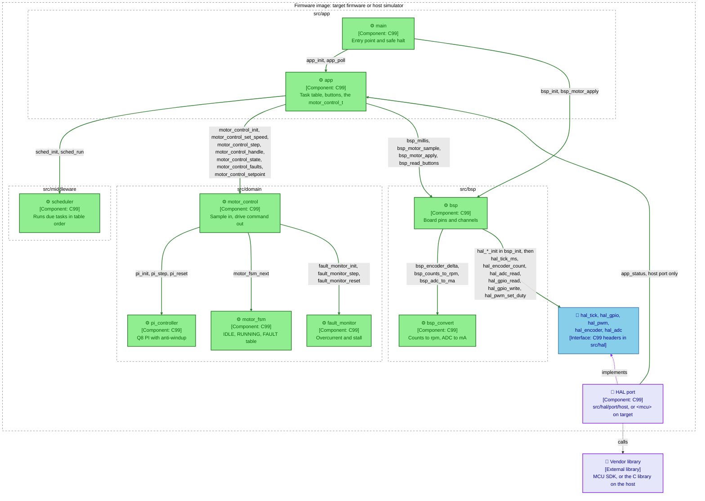

# Components of the firmware

Each component is one header and one source file with a single job. This technical diagram is for a reader who changes the code. It answers "what calls what". Each arrow points from the caller to the callee and names every function that the caller calls. Every name is a real function in `src/`.

The arrows end at the component inside each layer box, because the point of this view is which component calls which.

Two calls are easy to miss:

- The scheduler calls `control_task` and `ui_task` in `app.c` through the function pointers in its task table. The diagram has no arrow for them, because `scheduler.c` includes no `app` header.
- The host port calls `app_status` from `host_scenario_before_tick` to print one telemetry row every 10 ms. That call runs inside `hal_tick_ms`, so it happens in the middle of `app_poll`. [Runtime](05_runtime.md#how-the-host-port-advances-time) shows the order. A target port has no reason to call `app`, and [Layering](04_layering.md#what-the-check-does-not-cover) explains why no check stops it.

## Responsibilities and interfaces

| Component | Owns | Public interface | Verified by |
| --- | --- | --- | --- |
| `main` | Nothing. It runs `bsp_init`, then `app_init`, then `app_poll` forever. If `bsp_init` fails, it writes a disabled drive command forever | None | Nothing. `project.yml` excludes `src/app/main.c` from the unit tests |
| `app` | The single `app_t`: the `motor_control_t`, the previous button levels, the latest sample and command. Also the task table and the configuration built from `app_config.h` | `app.h`, `app_config.h` | `tests/unit/app/test_app.c` with a `bsp` mock |
| `scheduler` | Nothing. The caller owns the task array | `scheduler.h` | `tests/unit/middleware/test_scheduler.c` |
| `motor_control` | The state, the target and ramped setpoints, the last measured speed and applied duty, the latched faults | `motor_control.h` | `tests/unit/domain/test_motor_control.c` |
| `pi_controller` | The integral term | `pi_controller.h` | `tests/unit/domain/test_pi_controller.c` |
| `motor_fsm` | The `const` transition table. It has no mutable state | `motor_fsm.h` | `tests/unit/domain/test_motor_fsm.c` |
| `fault_monitor` | The stall counter | `fault_monitor.h` | `tests/unit/domain/test_fault_monitor.c` |
| `bsp` | The previous encoder count | `bsp.h`, `board_config.h` | `tests/unit/bsp/test_bsp.c` with HAL mocks |
| `bsp_convert` | Nothing. Pure conversion functions | `bsp_convert.h` | `tests/unit/bsp/test_bsp_convert.c` |
| `hal` | Nothing. Declarations only | `hal_types.h` and the five `hal_*.h` headers | No unit tests. `make sim` runs the host port |
| Host port | Simulated time, latched GPIO outputs, PWM duty, the motor model | `hal_*.h` | No unit tests. `make sim` runs it |

The domain types `rpm_t`, `milliamp_t`, `duty_permille_t`, `motor_sample_t` and `drive_cmd_t` are in `src/domain/motor_types.h`. The `app`, `domain` and `bsp` layers include it. The scheduler does not.

The API reference for every interface is in the Doxygen output under `build/doxygen/html`. The design reasons are in these ADRs:

- [ADR-0002 Link-time HAL ports](../adr/0002-link-time-hal-ports.md)
- [ADR-0003 Pure domain core](../adr/0003-pure-domain-core.md)
- [ADR-0004 Fixed-point arithmetic](../adr/0004-fixed-point-arithmetic.md)
- [ADR-0005 Cooperative scheduler](../adr/0005-cooperative-scheduler.md)
