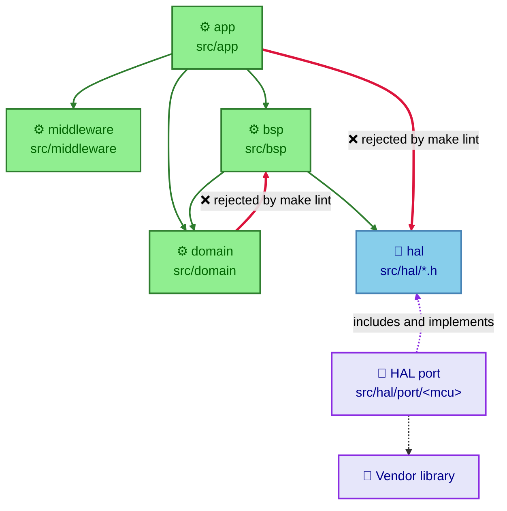

# Layering

This page lists the layers, what each layer may include, and the check that enforces the rule.

## Include rule

The technical diagram below answers "what may include what at build time". Each green arrow is an allowed include. Each red arrow is an example of an include that `make lint` rejects. Calls between components are on the [component page](03_components.md).

The table below states the same rule. It mirrors `ALLOWED` in `tools/check_layers.py`.

| Layer | Directory | May include |
| --- | --- | --- |
| app | `src/app/` | app, domain, middleware, bsp |
| domain | `src/domain/` | domain |
| middleware | `src/middleware/` | middleware |
| bsp | `src/bsp/` | bsp, hal, domain |
| hal | `src/hal/*.h` | hal |
| HAL port | `src/hal/port/<mcu>/` | Not checked. See [What the check does not cover](#what-the-check-does-not-cover) |

Every layer may also include `<stdint.h>`, `<stdbool.h>` and `<stddef.h>`. Any other header that is not under `src/` fails the check.

The `bsp` layer includes `motor_types.h` from the domain, so that `bsp.h` speaks in rpm and mA. The dependency points inward, toward the domain, and the domain stays free of board knowledge. See [ADR-0003](../adr/0003-pure-domain-core.md).

## Enforcement

`make lint` runs `tools/check_layers.py`. The script reads every `#include` in the `.c` and `.h` files under `src/`. It fails on an include that breaks the table above. Outside `src/hal/port/`, it also fails on a call to `malloc`, `calloc`, `realloc` or `free`, and on the words `float` and `double`. It ignores comments and string literals.

Each failure prints as `path:line: message`. For example, adding `#include "hal_pwm.h"` as line 9 of `src/app/app.c` prints:

	src/app/app.c:9: layer 'app' must not include 'hal_pwm.h' from layer 'hal'

The script finds a header's layer by its file name alone. Every build adds each source directory to the include path, so two layers must never use the same header name. The script fails when they do.

| Requirement | Check |
| --- | --- |
| [LINK: SWR-ARC-001] | The `ALLOWED` table in `tools/check_layers.py` |
| [LINK: SWR-DET-001] | The forbidden-word scan in `tools/check_layers.py` |

## What the check does not cover

The script skips every include, and every forbidden-word match, in files under `src/hal/port/`. A port has to include vendor headers, and the host port uses `double` for its motor model, which [ADR-0004](../adr/0004-fixed-point-arithmetic.md) allows. The script also reads nothing under `tests/`.

The host port uses that freedom beyond the HAL headers:

| File | Includes | Why |
| --- | --- | --- |
| `src/hal/port/host/hal_host.c` | `board_config.h` from bsp | To know which pin, channel and encoder ID it simulates |
| `src/hal/port/host/host_scenario.c` | `app.h` from app | To call `app_status` and print telemetry |
| `hal_host.c`, `host_plant.c` | `<math.h>` | Floating-point motor model and ADC encoding |
| `host_scenario.c` | `<stdio.h>`, `<stdlib.h>` | CSV output, and `exit` at the end of the scenario |

A target port needs only the HAL headers, its vendor headers and the C library. Nothing in the build enforces that limit, so a reviewer checks it.
