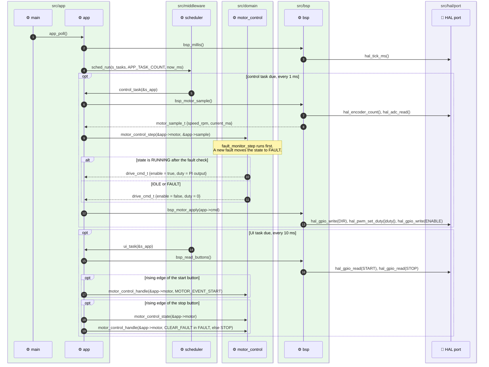
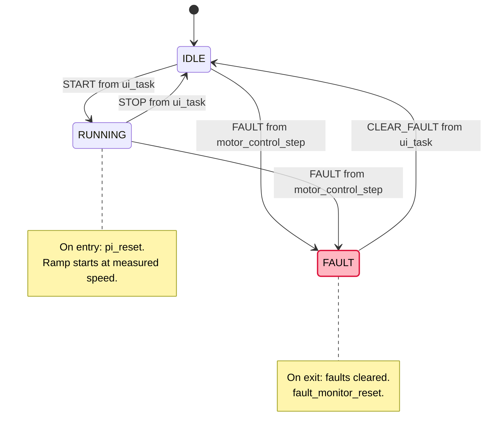
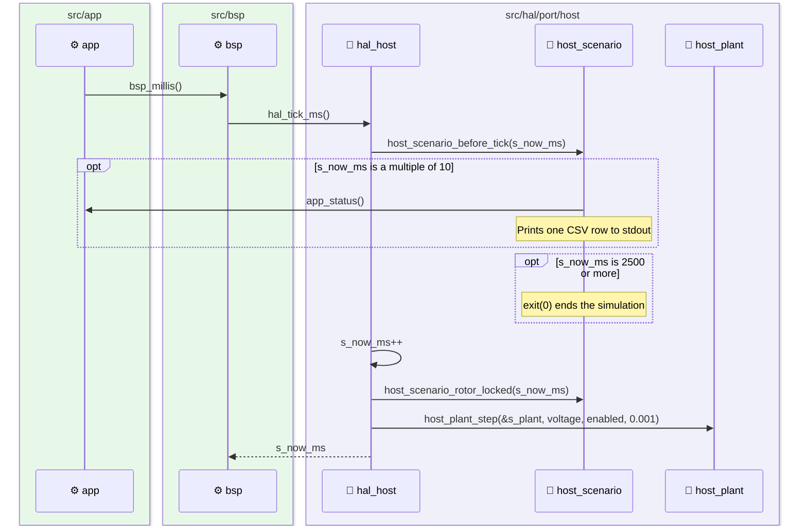

# Runtime behavior

The firmware has one thread of control, and no interrupt handlers above the HAL port. `main` calls `app_poll` in an endless loop. `app_poll` reads the millisecond tick once and passes it to `sched_run`, which runs each task whose period has elapsed. The outputs depend only on the tick and on the sampled inputs, which is what [LINK: SYS-007] asks for.

## One pass of the main loop

This technical sequence diagram shows the calls in one pass of the main loop, in the order the code makes them. Each colored band is one layer. Every message is a real function in `src/`. Most passes on a fast MCU find no task due and return after `sched_run`.

The task table in `app.c` lists `control_task` before `ui_task`, so when both are due in the same pass, the control task runs first.

Inside `motor_control_step` the order is fixed:

1. Store the sampled speed as the measured speed.
2. Run `fault_monitor_step` on the sample and on the duty applied in the previous step. A detected fault is latched, and `motor_control_handle` receives `MOTOR_EVENT_FAULT`.
3. If the state is not `RUNNING`, return `{enable = false, duty = 0}`.
4. Move the ramped setpoint toward the target by at most `ramp_rpm_per_tick`.
5. Run `pi_step` on `ramped setpoint - measured speed`, and return its output as the duty.

Step 2 comes before step 3, so a fault disables the drive in the same call that detects it ([LINK: SWR-CTL-004]). The fault monitor trips on these conditions:

| Fault | Condition | Default in `app_config.h` |
| --- | --- | --- |
| `FAULT_OVERCURRENT` | One sample with \|current\| above `overcurrent_ma` | 8000 mA |
| `FAULT_STALL` | \|duty\| at least `stall_min_duty` and \|speed\| below `stall_max_speed_rpm`, for `stall_ticks` consecutive steps | 300 ‰, 50 rpm, 100 steps |

## Scheduler timing

`sched_init` starts every task's first period at the current tick. A task is due when at least `period_ms` has passed since the start of its current period. When the task runs, the start of its period moves forward by exactly `period_ms`, not to the current tick, so the average rate does not drift when a pass is late.

A pass that is late by several periods runs each task at most once. The task then runs on each following pass until it has caught up. The elapsed time is computed in `uint32_t`, so it stays correct across the wrap of the tick after 49.7 days ([LINK: SWR-SCH-001]).

## Motor states

This technical state diagram shows every transition that `motor_fsm_next` can make, and the actions that `motor_control_handle` runs when the state changes. Each transition label names the event and the code that sends it.

`motor_fsm_next` is a lookup in a `const` table indexed by state and event. Every cell that the diagram does not draw maps a state to itself. In those cells `motor_control_handle` returns early and runs no action. The table is the single source of truth for [LINK: SWR-FSM-001], [LINK: SWR-FSM-002] and [LINK: SWR-FSM-003]. `tests/unit/domain/test_motor_fsm.c` checks all 12 cells.

The entry action on `RUNNING` is the bumpless start of [LINK: SWR-CTL-003]. The ramp starts from the current shaft speed. A motor that is still coasting when the operator presses start keeps turning, instead of being driven back toward zero first.

## User interface task

The 10 ms task reads both buttons and keeps the previous level of each. A rising edge of the start button sends `START`. A rising edge of the stop button sends `CLEAR_FAULT` when the state is `FAULT`, and `STOP` otherwise ([LINK: SWR-APP-002]). When both buttons rise in the same run, `START` is sent first.

`app_init` reads the buttons once before the first run. A button held down at power-up therefore produces no edge until it is released and pressed again.

The task debounces by sampling. If a contact settles in under 10 ms, at most one sample falls inside the bounce, so one press produces one rising edge.

## Timing budget

| Work | When | Work per run |
| --- | --- | --- |
| `app_poll` | Every pass of the main loop | 1 HAL read (`hal_tick_ms`), a loop over 2 task entries |
| `control_task` | Every 1 ms | 2 HAL reads, a fixed number of integer operations, 3 HAL writes |
| `ui_task` | Every 10 ms | 2 GPIO reads, at most 2 calls to `motor_control_handle` |

No task loops over data or allocates memory, so each run takes a bounded number of instructions on every target. [ADR-0005](../adr/0005-cooperative-scheduler.md) explains why both tasks share one cooperative scheduler.

## How the host port advances time

In the host simulator there is no real clock. This technical sequence diagram shows what one call to `hal_tick_ms` does in `src/hal/port/host/hal_host.c`. It is for a reader who changes the simulator or reads its telemetry.

Each call to `hal_tick_ms` advances the simulated time by exactly 1 ms. `app_poll` calls it once per pass, so in the simulator every pass of the main loop is 1 ms long and runs the control task. The motor model sees the PWM duty and the GPIO levels that the previous control step wrote.

The `app_status` call runs inside `app_poll`, between two control steps, so each CSV row shows the sample and command of the control step that has just finished.
