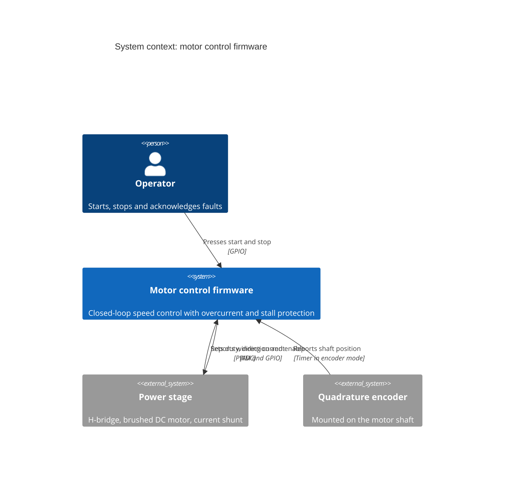

# System context

The firmware holds a brushed DC motor at a commanded speed. It reads the shaft speed from a quadrature encoder and the winding current from a shunt resistor, and it drives the motor through an H-bridge. An operator starts and stops the motor with two buttons. The firmware trips to a safe state on overcurrent or stall.

## What the system promises

| Promise | Requirement |
| --- | --- |
| Speed within 2 % of the setpoint, settled within 1 s | [LINK: SYS-001] |
| Start and stop from the buttons | [LINK: SYS-002] |
| Drive disabled within 1 ms of overcurrent | [LINK: SYS-003] |
| Drive disabled when the rotor stalls | [LINK: SYS-004] |
| Drive stays off until the operator acknowledges a fault | [LINK: SYS-005] |
| Logic above the HAL port runs on any MCU | [LINK: SYS-006] |
| Fixed 1 ms loop with integer arithmetic | [LINK: SYS-007] |
| All logic above the HAL port tests on a PC | [LINK: SYS-008] |

The `[LINK: ...]` tags resolve to the requirement pages in the StrictDoc export. On GitHub they show as plain text.

## Out of scope

The example has no communication interface, no non-volatile parameter storage and no bootloader. Each of those would be a new middleware module behind its own header, and none of them changes the layer rule in [Layering](04_layering.md).
