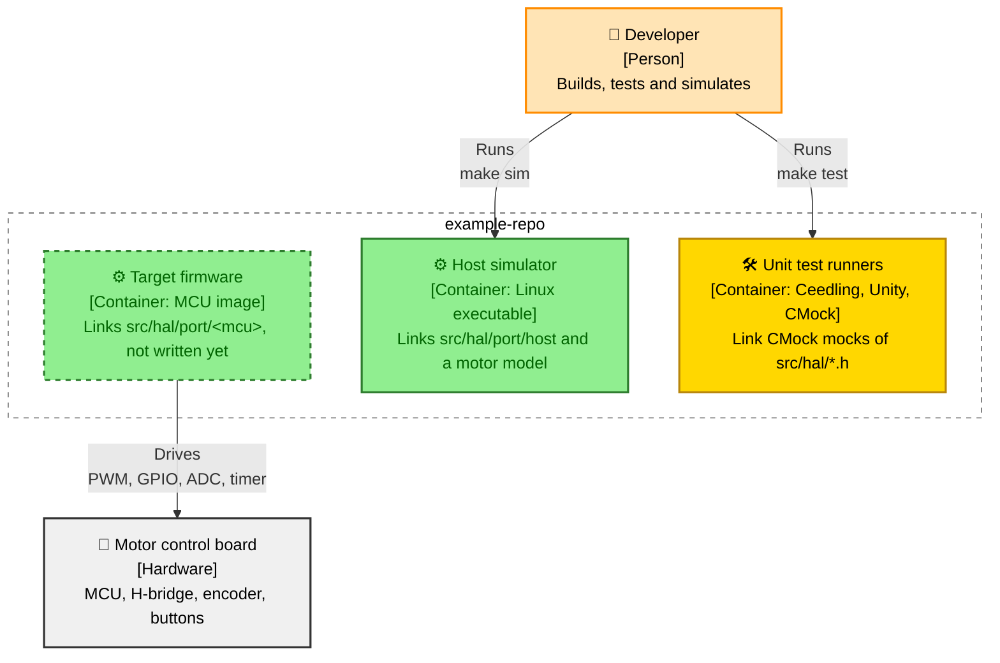

# Containers

One source tree builds three executables. All three compile the same `app`, `domain`, `middleware` and `bsp` sources. They differ only in what stands behind the HAL headers. That shared code is the evidence for the portability requirement [LINK: SYS-006].

This overview diagram shows the three executables and who runs each one. The second line of each box names the HAL implementation that the executable links. Arrows point the way a command or signal travels.

The dashed border marks the target firmware as planned work. Its MCU port does not exist yet. [Port the firmware to a new MCU](06_porting_guide.md) lists the files the port needs. The source sets and HAL ports are not containers, because none of them is deployed on its own. They appear on the [component page](03_components.md).

| Container | Command | HAL implementation | Purpose |
| --- | --- | --- | --- |
| Target firmware | The vendor toolchain for the chosen MCU | `src/hal/port/<mcu>/` | The product |
| Host simulator | `make sim` | `src/hal/port/host/` | Closed-loop check of [LINK: SYS-001] and [LINK: SYS-004] without hardware |
| Unit test runners | `make test` | CMock mocks of `src/hal/*.h` and `src/bsp/bsp.h` | Behavior of each module, see [LINK: SYS-008] |
| Documentation site | `make docs` | None | Requirements, architecture, ADRs and the API reference in `build/strictdoc` and `build/doxygen` |

[ADR-0007](../adr/0007-c4-views-as-flowcharts.md) explains why this C4 view is a flowchart and not a native `C4Container` diagram.
