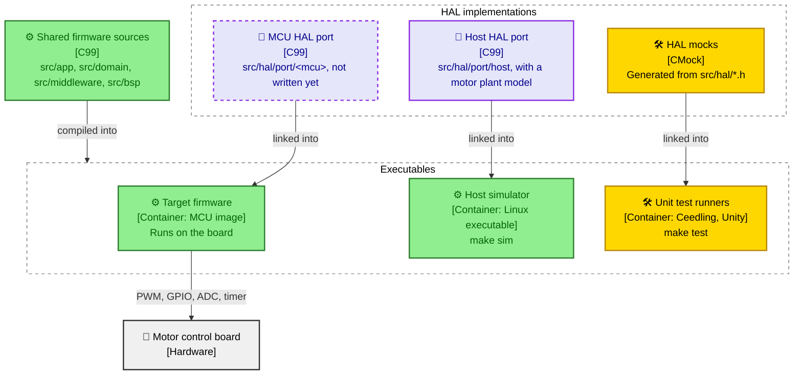

# Containers

One source tree builds three executables. They share the same `app`, `domain`, `middleware` and `bsp` sources and differ only in what stands behind the HAL headers. That shared code is the evidence for the portability requirement [LINK: SYS-006].

This overview diagram answers one question: which executable links which HAL implementation. Arrows point from the source code to the executable built from it. The arrow into the **Executables** box means all three executables compile the shared sources.

The dashed border marks the MCU port as planned work. [Port the firmware to a new MCU](06_porting_guide.md) lists the files it needs.

| Container | Command | HAL implementation | Purpose |
| --- | --- | --- | --- |
| Target firmware | The vendor toolchain for the chosen MCU | `src/hal/port/<mcu>/` | The product |
| Host simulator | `make sim` | `src/hal/port/host/` | Closed-loop check of [LINK: SYS-001] and [LINK: SYS-004] without hardware |
| Unit test runners | `make test` | CMock mocks of `src/hal/*.h` and `src/bsp/bsp.h` | Behavior of each module, see [LINK: SYS-008] |
| Documentation site | `make docs` | None | Requirements, architecture, ADRs and the API reference in `build/strictdoc` and `build/doxygen` |
