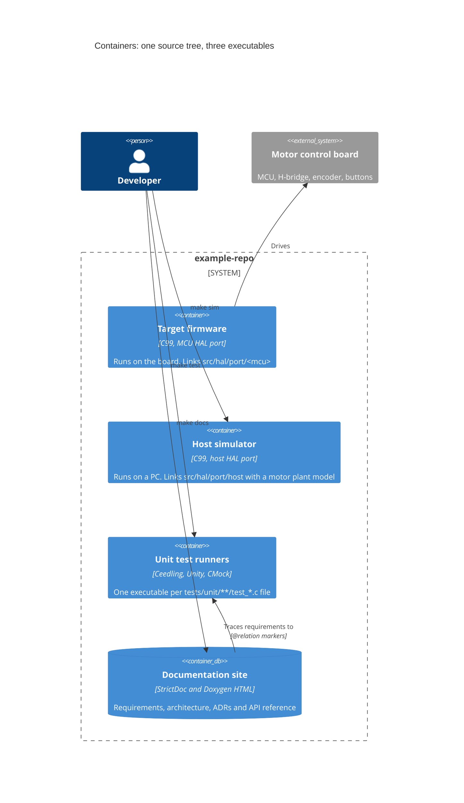

# Containers

One source tree builds three executables. They differ only in the HAL port they link and in who calls the code. The same `app`, `domain`, `middleware` and `bsp` sources run in all three, which is the evidence for the portability requirement [LINK: SYS-006].

| Container | Built by | HAL implementation | Purpose |
| --- | --- | --- | --- |
| Target firmware | The vendor toolchain for the chosen MCU | `src/hal/port/<mcu>/` | The product |
| Host simulator | `make sim` | `src/hal/port/host/` | Closed-loop check of [LINK: SYS-001] and [LINK: SYS-004] without hardware |
| Unit test runners | `make test` | CMock mocks of `src/hal/*.h` and `src/bsp/bsp.h` | Behavior of each module, see [LINK: SYS-008] |
| Documentation site | `make docs` | none | Requirements, design and API in one place |

The repo ships only the host port. [Porting to a new MCU](06_porting_guide.md) lists the files a target port adds.
