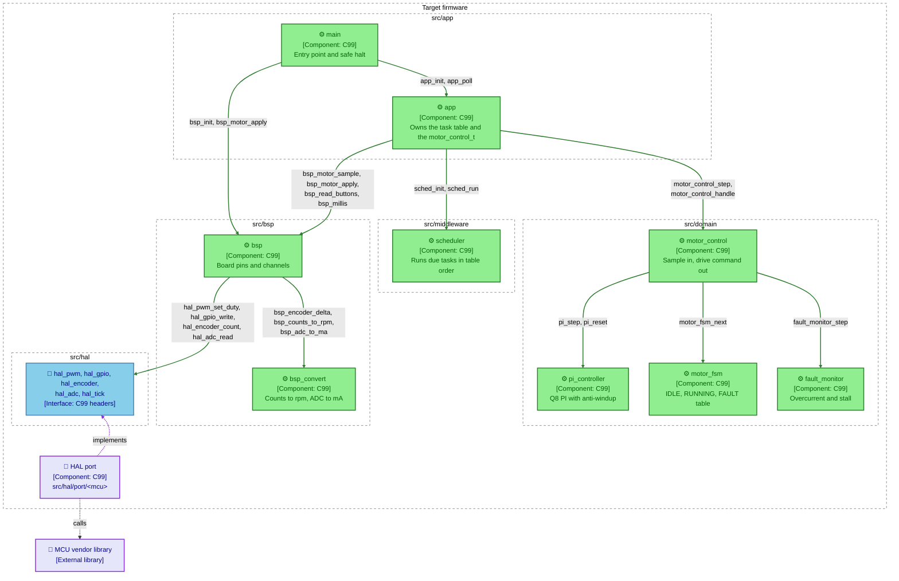

# Components of the firmware

Each component is one header and one source file with a single job. This technical diagram is for a reader who changes the code. It answers "what calls what at run time". Each arrow points from the caller to the callee and names the functions it calls. Every name is a real function in `src/`.

The arrows end at the component inside each layer box because the point of this view is which component calls which. The scheduler calls back into `app` through the function pointers in its task table. That callback is not drawn, because `scheduler.c` includes no `app` header.

## Responsibilities and interfaces

| Component | Owns | Public interface | Verified by |
| --- | --- | --- | --- |
| `app` | The single `motor_control_t`, the task table, the button edge state | `app.h` | `tests/unit/app/test_app.c` |
| `scheduler` | Nothing. The caller owns the task array | `scheduler.h` | `tests/unit/middleware/test_scheduler.c` |
| `motor_control` | State, ramped setpoint, latched faults | `motor_control.h` | `tests/unit/domain/test_motor_control.c` |
| `pi_controller` | The integral term | `pi_controller.h` | `tests/unit/domain/test_pi_controller.c` |
| `motor_fsm` | The transition table. It has no state of its own | `motor_fsm.h` | `tests/unit/domain/test_motor_fsm.c` |
| `fault_monitor` | The stall counter | `fault_monitor.h` | `tests/unit/domain/test_fault_monitor.c` |
| `bsp` | Previous encoder count, board constants | `bsp.h`, `board_config.h` | `tests/unit/bsp/test_bsp.c` with HAL mocks |
| `bsp_convert` | Nothing. Pure conversion functions | `bsp_convert.h` | `tests/unit/bsp/test_bsp_convert.c` |
| `hal` | Nothing. Interfaces only | `hal_*.h` | Each port's own bring-up tests |

The API reference for every interface is in the Doxygen output under `build/doxygen/html`. The design reasons are in these ADRs:

- [ADR-0002 Link-time HAL ports](../adr/0002-link-time-hal-ports.md)
- [ADR-0003 Pure domain core](../adr/0003-pure-domain-core.md)
- [ADR-0004 Fixed-point arithmetic](../adr/0004-fixed-point-arithmetic.md)
- [ADR-0005 Cooperative scheduler](../adr/0005-cooperative-scheduler.md)
