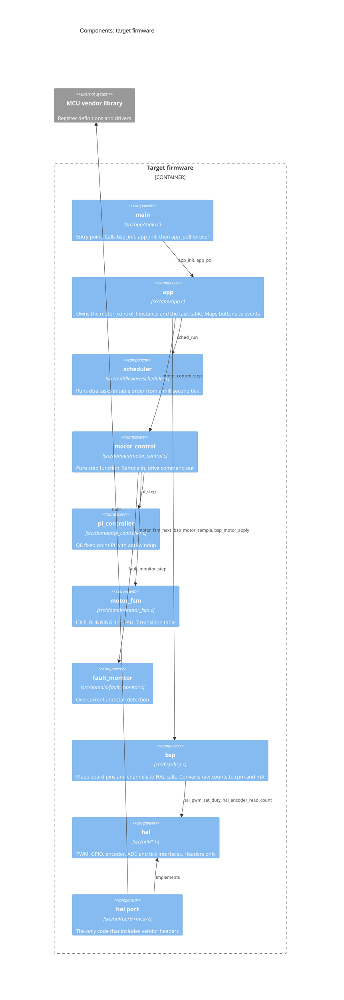

# Components of the firmware

Each component is one header and one source file with a single job. Arrows point from the caller to the interface it calls. No arrow points upward, and no component above `hal` sees a vendor type.

## Responsibilities and interfaces

| Component | Owns | Public interface | Verified by |
| --- | --- | --- | --- |
| `app` | The single `motor_control_t`, the task table, the button edge state | `app.h` | `tests/unit/app/test_app.c` |
| `scheduler` | Nothing. The caller owns the task array | `scheduler.h` | `tests/unit/middleware/test_scheduler.c` |
| `motor_control` | State, ramped setpoint, latched faults | `motor_control.h` | `tests/unit/domain/test_motor_control.c` |
| `pi_controller` | The integral term | `pi_controller.h` | `tests/unit/domain/test_pi_controller.c` |
| `motor_fsm` | The transition table. It has no state of its own | `motor_fsm.h` | `tests/unit/domain/test_motor_fsm.c` |
| `fault_monitor` | The stall counter | `fault_monitor.h` | `tests/unit/domain/test_fault_monitor.c` |
| `bsp` | Previous encoder count, board constants | `bsp.h`, `board_config.h` | `tests/unit/bsp/test_bsp.c` with HAL mocks, `tests/unit/bsp/test_bsp_convert.c` |
| `hal` | Nothing. Interfaces only | `hal_*.h` | Each port's own bring-up tests |

The API reference for every interface is in the Doxygen output under `build/doxygen/html`. The design reasons are in the ADRs:

- [ADR-0002 Link-time HAL ports](../adr/0002-link-time-hal-ports.md)
- [ADR-0003 Pure domain core](../adr/0003-pure-domain-core.md)
- [ADR-0004 Fixed-point arithmetic](../adr/0004-fixed-point-arithmetic.md)
- [ADR-0005 Cooperative scheduler](../adr/0005-cooperative-scheduler.md)
