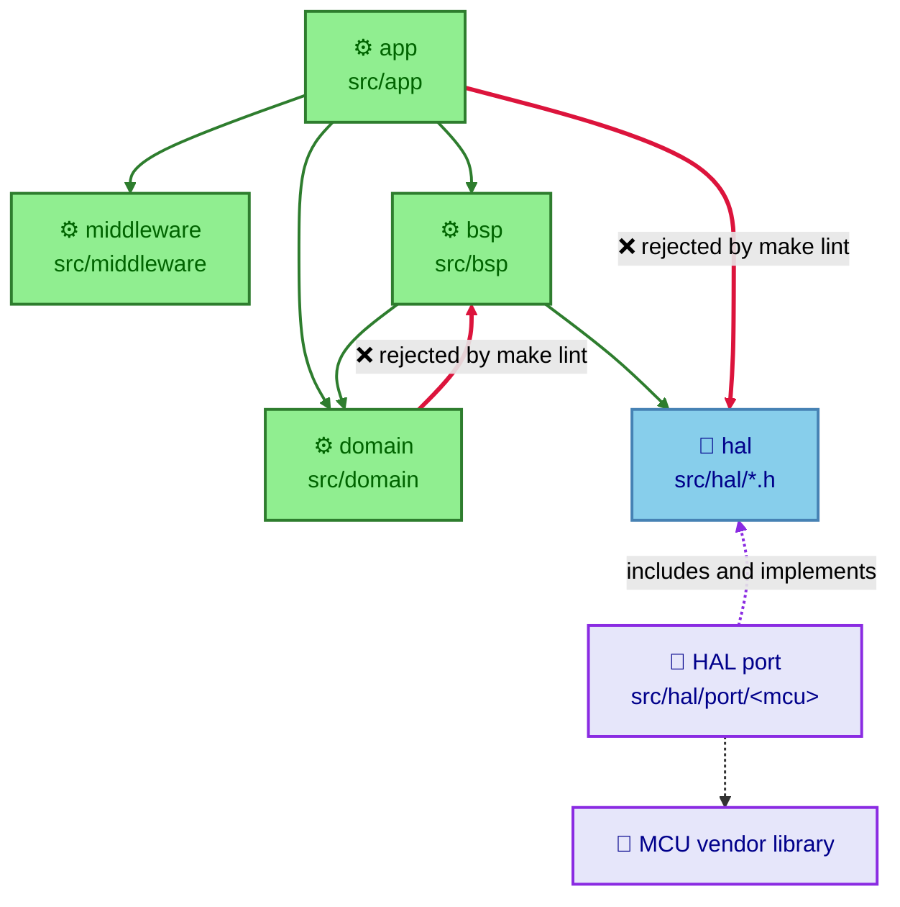

# Layering

This page lists the layers, what each layer may include, and the check that enforces the rule.

## Include rule

The technical diagram below answers "what may include what at build time". Each green arrow is an allowed include. Each red arrow is an include that `make lint` rejects. Run-time calls are on the [component page](03_components.md).

The same rule as a table:

| Layer | Directory | May include |
| --- | --- | --- |
| app | `src/app/` | app, domain, middleware, bsp |
| domain | `src/domain/` | domain |
| middleware | `src/middleware/` | middleware |
| bsp | `src/bsp/` | bsp, hal, domain |
| hal | `src/hal/*.h` | hal |
| hal port | `src/hal/port/<mcu>/` | hal, vendor headers, the C library |

Every layer may include `<stdint.h>`, `<stdbool.h>` and `<stddef.h>`.

The `bsp` layer includes `domain/motor_types.h` so that `bsp.h` speaks in rpm and mA. The dependency points inward, toward the domain, so the domain stays free of board knowledge. See [ADR-0003](../adr/0003-pure-domain-core.md).

## Enforcement

`make lint` runs `tools/check_layers.py`. The script reads every `#include` under `src/` and fails on an include that breaks the table above. It also fails on `malloc`, `calloc`, `realloc`, `free`, `float` or `double` outside `src/hal/port/`. Adding `#include "hal_pwm.h"` to `src/app/app.c` prints:

	src/app/app.c:9: layer 'app' must not include 'hal_pwm.h' from layer 'hal'

| Requirement | Check |
| --- | --- |
| [LINK: SWR-ARC-001] | `tools/check_layers.py` include table |
| [LINK: SWR-DET-001] | `tools/check_layers.py` forbidden tokens |
