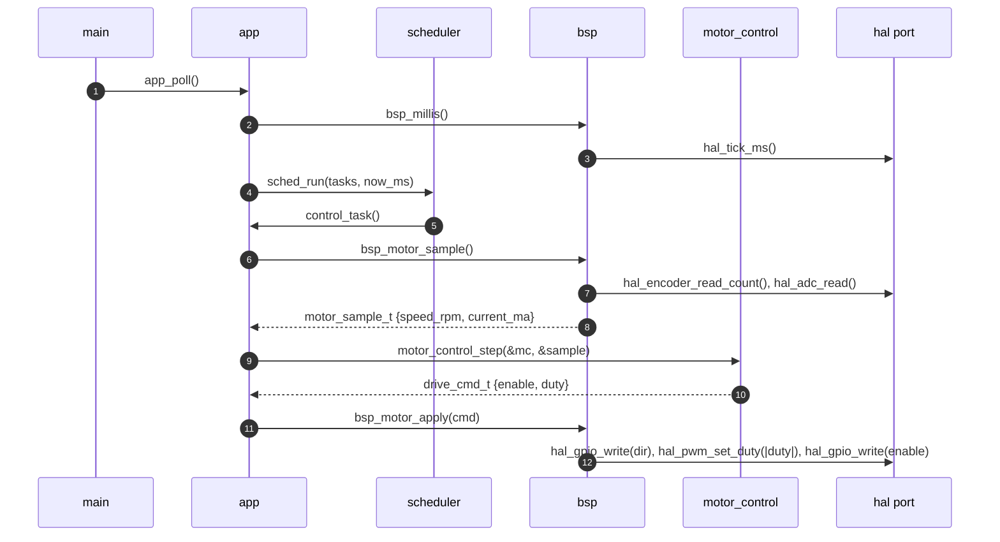
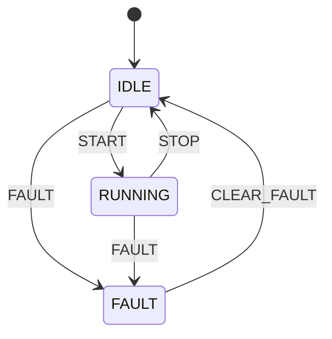

# Runtime behavior

The firmware has one thread of control and no interrupts above the HAL port. `main` polls `app_poll` in a loop. `app_poll` reads the millisecond tick and hands it to the scheduler, which runs each task whose period has elapsed. Behavior depends only on the tick and the sampled inputs, which is what [LINK: SYS-007] asks for.

## The 1 ms control tick

Inside `motor_control_step` the order is fixed:

1. Run the fault monitor on the sample and the previous duty. A new fault latches and sends `FAULT` to the state machine.
2. If the state is not `RUNNING`, return `{enable = false, duty = 0}`.
3. Move the ramped setpoint toward the target by at most `ramp_rpm_per_tick`.
4. Run the PI controller on `ramped setpoint - measured speed` and return its output as the duty.

Step 1 comes first, so a fault disables the drive in the same call that detects it ([LINK: SWR-CTL-004]).

## Motor states

`motor_fsm_next` is a lookup in a `const` table indexed by state and event. Every cell not drawn above maps a state to itself. The table is the single source of truth for [LINK: SWR-FSM-001], [LINK: SWR-FSM-002] and [LINK: SWR-FSM-003], and `tests/unit/domain/test_motor_fsm.c` checks every cell.

## User interface task

The 10 ms task reads both buttons and keeps the previous level of each. A rising edge of the start button sends `START`. A rising edge of the stop button sends `CLEAR_FAULT` when the state is `FAULT`, and `STOP` otherwise ([LINK: SWR-APP-002]). Sampling every 10 ms also debounces contacts that settle in under 10 ms.

## Timing budget

| Task | Period | Work per run |
| --- | --- | --- |
| control | 1 ms | 2 HAL reads, a fixed number of integer operations, 3 HAL writes |
| ui | 10 ms | 2 GPIO reads, at most 1 event |

Neither task loops over data or allocates memory, so each run takes a bounded number of instructions on every target.
